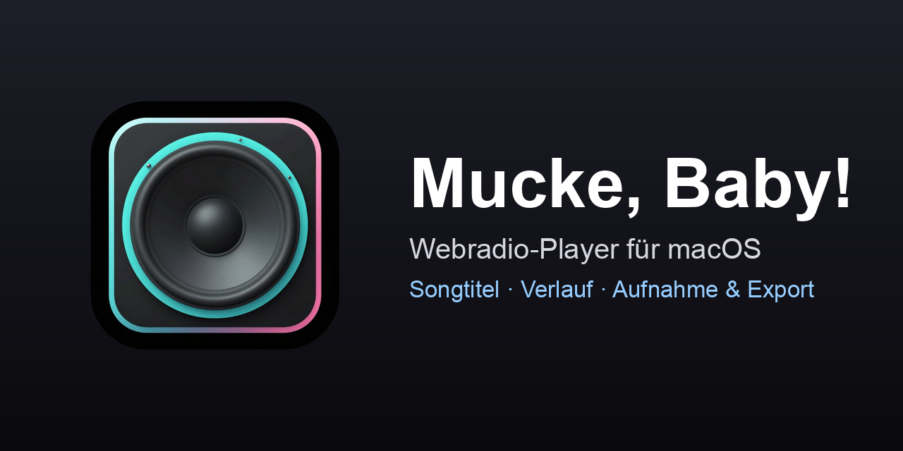
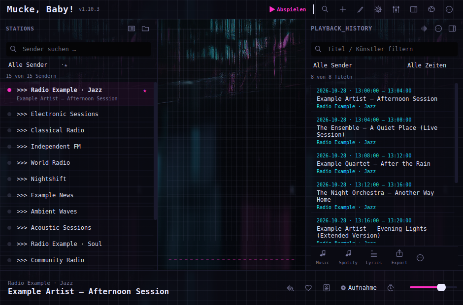
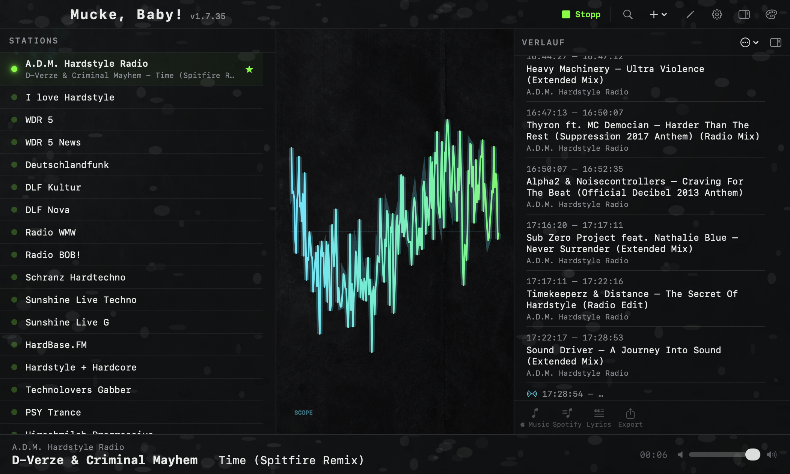
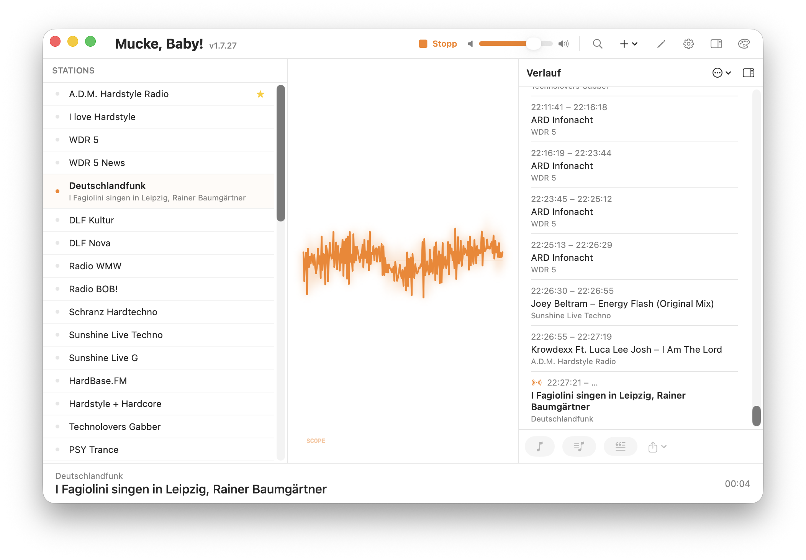
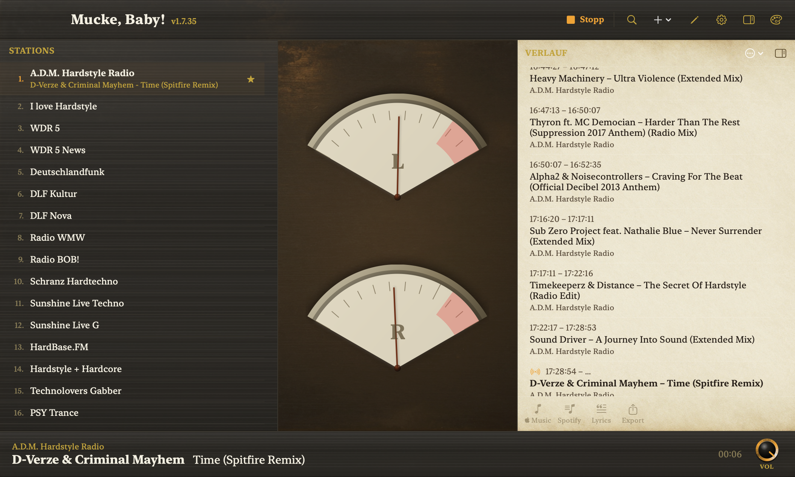
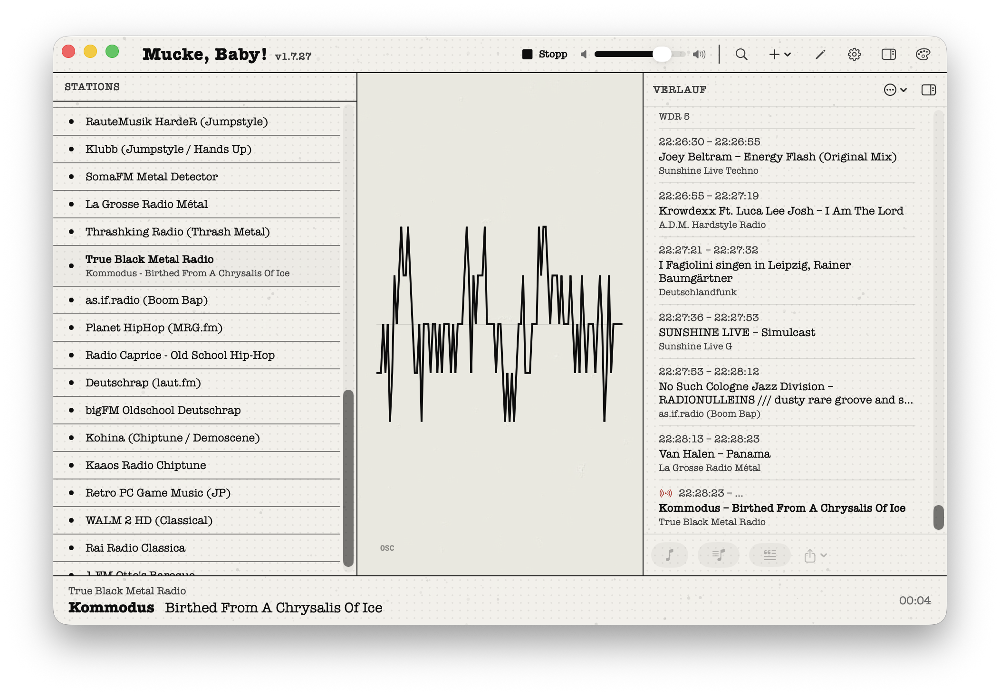
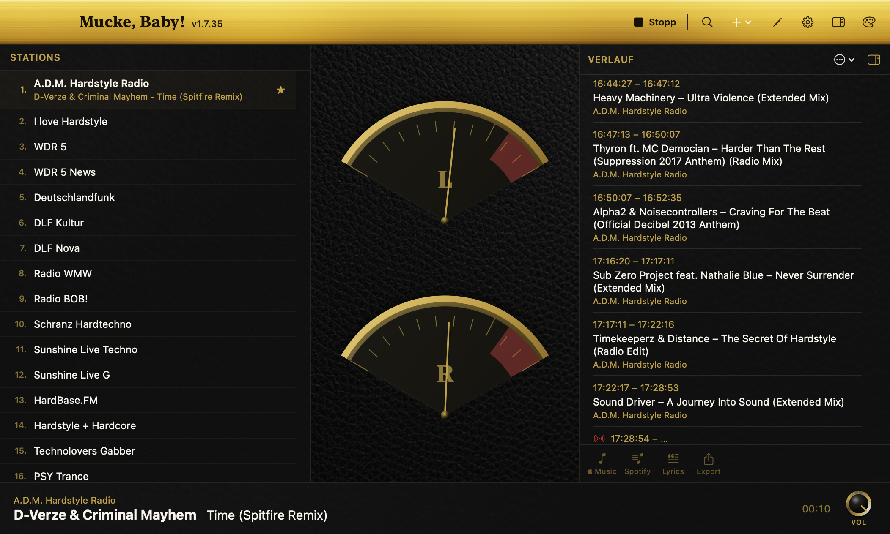
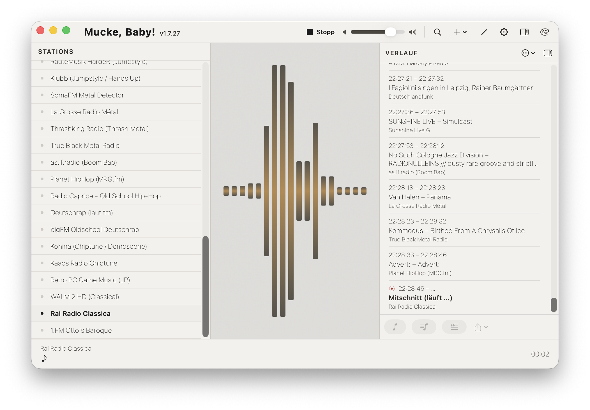
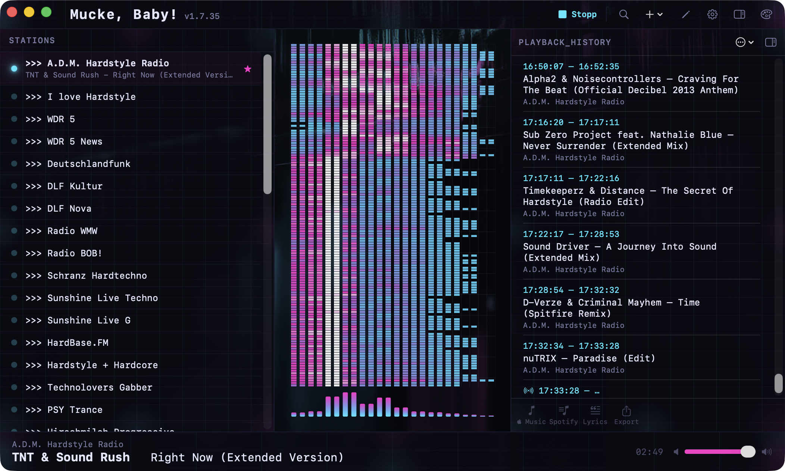

# Mucke, Baby!

**🌐 Sprache / Language:** [English](README.md) · [Deutsch](README.de.md)



Mucke, Baby! ist ein nativer Internetradio-Player für macOS und Linux mit sieben Themes, audio-reaktiven Visualizern, Titelverlauf und optionaler Stream-Aufnahme samt songweisem Export.

Die Oberfläche ist auf Deutsch und Englisch verfügbar. Der iPhone-Ableger heißt [Baby, Mucke!](https://github.com/DanielMuellerIR/baby_mucke).

## Download

- **Linux x86-64:** [Version 1.10.16 herunterladen](https://github.com/DanielMuellerIR/mucke_baby/releases/tag/v1.10.16). Das TAR.GZ-Archiv enthält einen Installer für das eigene Benutzerkonto; Qt, libVLC 3 und FFmpeg kommen aus den Systempaketen. Die [Linux-Anleitung](docs/linux.md) beschreibt Prüfsumme, Abhängigkeiten und Installation mit `./install.sh`.
- **macOS 14.2+, Apple Silicon:** [Signiertes und notarisiertes DMG, v1.10.16](https://github.com/DanielMuellerIR/mucke_baby/releases/tag/v1.10.16). Öffnen und *Mucke, Baby!* in den Programme-Ordner ziehen.

## Linux

Die native Qt-6-Anwendung ist unter Linux Mint 22 und CachyOS auf x86-64 geprüft. Enthalten sind Radiowiedergabe, ICY-Verlauf, Sender und Gruppen, Katalogsuche, Merkliste, Aufnahme, songweiser M4A-Export, begrenzter MP3-/AAC-Zeitversatz, sieben Themes, Miniplayer, Equalizer, Einschlaftimer und MPRIS-Desktopsteuerung.

Unter **Hilfe → Nach Updates suchen** lassen sich Updates prüfen und installieren; die automatische Suche beim Start ist in den Einstellungen zuschaltbar. Qt, libVLC 3 und FFmpeg kommen aus den Systempaketen. ShazamKit-Erkennung, Apple-Kurzbefehle und Sparkle-Updates bleiben macOS-spezifisch. Aus dem Quellcode bauen und installieren: `./build.sh` und `./install.sh`. Einrichtung, Datenpfade, Codecgrenzen und Tests stehen in der [Linux-Anleitung](docs/linux.md).

Black MIDI ist das Linux-Standardtheme. Unter 780 Pixeln Fensterbreite verschwindet der mittlere Visualizer. Ist kein weiteres Visualizer-Fenster sichtbar, pausiert seine Analyse; die Radiowiedergabe läuft weiter.



## Screenshots

Die folgenden Bilder zeigen die macOS-App. Das Linux-Bild oben zeigt die native Qt-Oberfläche mit denselben sieben Themes.

<p align="center"></p>

| Standard | Retro | Fanzine |
|:--:|:--:|:--:|
|  |  |  |
| **GuitarAmp** | **Danish** | **Black MIDI** |
|  |  |  |

## Unter macOS starten (Kommandozeile / headless-tauglich)

Kein Xcode-Projekt — die App wird mit `swiftc` zu einem `.app`-Bundle kompiliert. Erforderlich ist Xcode mit den Werkzeugen für App-Intents-Metadaten. Der Build läuft über Shell-Skripte.

```bash
./build.sh                                       # baut "build/Mucke, Baby!.app" (lädt VLCKit einmalig, ~84 MB)
./run.sh                                         # bauen + starten
open "build/Mucke, Baby!.app"                    # starten
"build/Mucke, Baby!.app/Contents/MacOS/MuckeBaby" # starten mit Logs (Debug)
```

### Headless / Automatisierung

- **Headless-Regressionstests:** `bash Tests/run-tests.sh` führt die vorhandenen Harnesses auf Apple-Silicon-macOS aus, ohne App-Start oder VLCKit-Download. HTTP-Fixtures nutzen ausschließlich Loopback. Der macOS-CI-Job führt denselben Befehl aus und baut und prüft das App-Bundle mit den festgelegten Framework-Versionen.
- **Exportcodecs und Schnittpositionen:** `python3 Tests/export-codecs.py` und `python3 Tests/export-positions.py` erzeugen temporäre Audiofixtures und dekodieren Exporte unabhängig mit FFmpeg. Die Positionsprüfung vergleicht markierte Schnitte mit und ohne Fade und prüft bytegleiche Vorhör- und Speicherdateien. Beide Befehle benötigen FFmpeg; lesbare Quellcodecs hängen von der macOS-Version ab.
- **Equalizer-Signalprüfung:** `python3 Tests/audio-effects.py` misst den gepinnten VLCKit-Equalizer über seinen PCM-Dateiausgang, unabhängig mit FFmpeg dekodiert. Geprüft werden neutraler Pegel, eine gezielte Bandabsenkung und Headroom. Der Dateiausgang besitzt keinen Lautstärkeregler; er ersetzt keine CoreAudio-, Stumm- oder Hörprüfung.
- **Automatische Theme-Screenshots:** `MUCKE_SHOTS=<verzeichnis>` setzen — die App schaltet durch alle Themes, schreibt je ein PNG und beendet sich. `MUCKE_SHOT_W=<punkte>` überschreibt die Fensterbreite; die Layoutbaseline nutzt 940 und 660 macOS-Punkte.
  ```bash
  MUCKE_SHOTS=/tmp/shots "build/Mucke, Baby!.app/Contents/MacOS/MuckeBaby"
  ```
  Dafür einen Testbenutzer verwenden oder vorher App-Preferences sichern und danach wiederherstellen: Der Screenshotlauf verändert das gewählte Theme. `CFFIXED_USER_HOME` isoliert Dateien, aber nicht zuverlässig den Preferences-Daemon.
- **Installieren oder Release bauen** — drei Einstiegspunkte, bewusst getrennt:
  ```bash
  ./build.sh                        # baut nur, bleibt in build/
  ./install.sh                      # baut, notarisiert, installiert nach /Applications
  ./release.sh                      # baut, notarisiert, packt das DMG — installiert nie
  ./release.sh --no-finder-layout   # ohne Finder-Fensterlayout (für headless Läufe)
  ```
  `install.sh` und `release.sh` notarisieren zuerst die **App selbst** und heften ihr das
  Ticket an. Das zählt hier doppelt: Eine aus dem Disk-Image herausgezogene App hätte sonst
  kein eigenes Ticket, und Sparkle entpackt die neue Version beim Update selbst.
  Der notarytool-Profilname kommt aus `NOTARY_PROFILE` oder
  `git config --local muckeBaby.notaryProfile <profil>` — Keychain-Profile sind pro Mac
  lokal und werden nie synchronisiert.

## macOS-Funktionen

### Wiedergabe und Darstellung

- **Internetradio** spielt MP3, AAC, Ogg/Vorbis, Opus, FLAC und weitere Formate über VLCKit. Die App löst PLS-, M3U-, ASX-, XSPF- und Tune.ashx-Playlists auf. Starte von Hand, mit dem letzten oder mit einem fest gewählten Sender. Nach Verbindungsfehlern versuchen Wiedergabe und Metadatenverbindung unabhängig voneinander einen Neustart.
- **Zeitversatz** nutzt die vorhandene Stream-Verbindung für einen optionalen MP3-/AAC-ADTS-Puffer. Hauptfenster und Miniplayer teilen Pause, Sprünge, Titelzeitleiste und Rückkehr zu Live. Der Puffer hält bis zu fünf Minuten und 32 MiB komprimiertes Audio, stoppt unter 10 GiB freiem Speicher und leert sich bei Senderwechsel oder beim Beenden. HLS spielt live. Siehe [Puffer und Formatgrenzen](docs/timeshift-buffer.md).
- **Sieben Themes** stehen für Hauptfenster, Miniplayer und Vollbild-Visualizer bereit. Der Miniplayer lässt sich im Vordergrund halten. Zehnband-Equalizer, Senderpegel und Einschlaftimer wirken auf die Wiedergabe. Aufnahmen behalten die ursprünglichen Audiobytes.

### Sender, Verlauf und Merkliste

- **Eigene Sender** lassen sich sortieren, gruppieren, suchen und als Favoriten markieren. ⌘K öffnet die Schnellauswahl. Fünf Tastenkürzel sind frei belegbar. Importiere kuratierte Genre-Listen oder filtere und höre Vorschläge aus [Radio Browser](https://www.radio-browser.info) vor. Bei Katalogsendern kannst du eine vorgeschlagene Ersatzadresse vergleichen und ausdrücklich übernehmen.
- **Der Verlauf** zeigt ICY-Titel mit Sender und Zeit. Suche nach Titel oder Zeitraum, öffne Musiklinks zu Apple Music und Spotify oder speichere Titel in der unabhängigen Merkliste. Die Merkliste exportiert sichtbare Treffer als UTF-8-Text oder CSV.
- **Bibliotheksaustausch** zeigt Importe vor dem Speichern in einer Vorschau und fragt bei Konflikten nach. Sender, Gruppen und gemerkte Titel lassen sich als JSON austauschen. Aufnahmen, Verlauf und Geräteeinstellungen bleiben lokal. Siehe [Austauschformate](docs/library-exchange.md).

### Aufnahme und Export

- **Stream-Aufnahme** ist standardmäßig aus. Aktiviert schreibt sie über die bestehende Metadatenverbindung nach `~/Music/MuckeBaby/Aufnahmen/`, stoppt unter 10 GiB freiem Speicher und zeigt Warte-, Aufnahme- und Fehlerzustände. Die Bibliothek listet Dateien unabhängig vom Verlauf und kann abgeschlossene Aufnahmen vorhören.
- **M4A-Export** bietet Start- und Endkorrektur, optionale Blenden und Vorhören der vorbereiteten Datei. Interpret, Titel und Sender bleiben als Metadaten erhalten. Stapel mit bis zu 100 Titeln zeigen jedes Ergebnis und erlauben Abbruch.
- **Löschen** erfordert eine Bestätigung, wenn der gesamte Verlauf geleert wird. Die Aufnahmen bleiben dabei erhalten. Eine eigene Aktion löscht alle abgeschlossenen Aufnahmen und erhält Verlauf sowie laufende Aufnahme.

### macOS-Integration

- **Mediensteuerung und Kurzbefehle** zeigen Sender und Titel im Kontrollzentrum. [Apple-Kurzbefehle](docs/shortcuts.md) können gespeicherte Sender starten, stoppen, die Lautstärke setzen, Titel abfragen und merken.
- **Musik erkennen** öffnest du über die Wellenform-Suche. Shazam bekommt einen Fingerabdruck von bis zu zwölf Sekunden gehörter Musik. Du kannst abbrechen, den Treffer für die Anzeige übernehmen oder mit seiner Herkunft merken. Die Erkennung benötigt Audiofreigabe und Internet. Bei eigenen Builds muss ShazamKit für die signierte App-ID aktiviert sein.
- **Updates** nutzen den signierten Sparkle-Feed und werden nach Bestätigung installiert. Die App braucht weder Konten noch Telemetrie.

### Audiofreigabe

Visualizer und Musikerkennung analysieren die eigene Ausgabe über einen CoreAudio-Process-Tap. macOS kann beim ersten Start des Taps um Freigabe bitten. Mit derselben Developer-ID-Signatur und Bundle-ID erkennt macOS die App über Builds hinweg. Radio spielt auch ohne Freigabe weiter. Bei Lautstärke null gibt es kein Signal für die Visualizer.

## Daten

Unter macOS liegen die Sender in einer editierbaren JSON-Datei:

```
~/Library/Application Support/MuckeBaby/stations.json
```

Beim ersten Start wird sie aus `Resources/seed-stations.json` befüllt, falls vorhanden, sonst aus der generischen `Resources/seed-stations.example.json` (die einzige mitgelieferte Liste).

## Fremdbestandteile & Lizenzen

Vollständige Aufstellung in [`THIRD-PARTY.md`](THIRD-PARTY.md). Kurz:

- **VLCKit / libVLC** — **LGPL-2.1-or-later**, dynamisch gelinkt und im Bundle austauschbar. Quelle: <https://code.videolan.org/videolan/VLCKit>.
- **Theme-Texturen & App-Icon** — lokal mit einem Apache-2.0-Modell erzeugt.
- **Qt 6 und libpulse** — Systembibliotheken unter Linux; vollständige Hinweise und Quelllinks stehen in `THIRD-PARTY.md`.
- **Schriften** — Systemschriften; das Linux-Fanzine-Theme enthält Zilla Slab unter der SIL Open Font License 1.1. **Sender-URLs** sind Fakten; die Streams gehören den jeweiligen Sendern.

**Projekt-Lizenz:** [MIT](LICENSE) für den eigenen Quellcode dieses Projekts. Das eingebettete VLCKit/libVLC behält seine **LGPL-2.1-or-later**-Lizenz (dynamisch gelinkt und austauschbar; Pflichten erfüllt durch diesen Hinweis + den Quell-Link oben).

## Voraussetzungen

- **macOS-Quellcodebau:** macOS 14.2+, Apple Silicon und Xcode einschließlich der Werkzeuge für App-Intents-Metadaten.
- **Linux:** x86-64, Qt ab 6.4, libVLC 3 und PulseAudio oder PipeWire-Pulse. FFmpeg wird für den Export benötigt. Siehe [Laufzeit- und Buildabhängigkeiten](docs/linux.md).


Vom Linux-Mint-Applet Radio++ inspiriert; es wurde kein Code und kein Asset von Radio++ übernommen.
