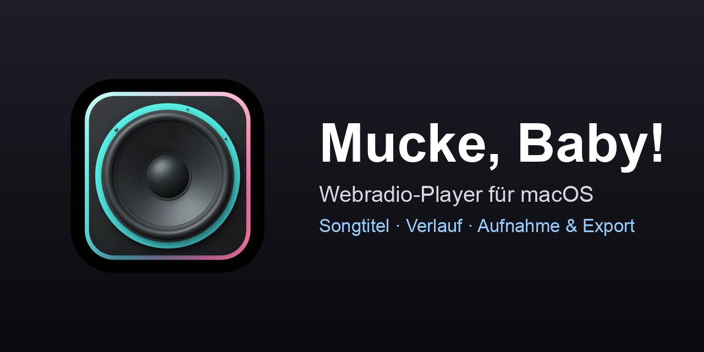
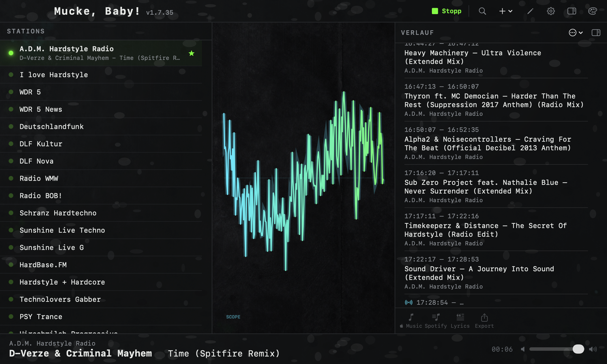
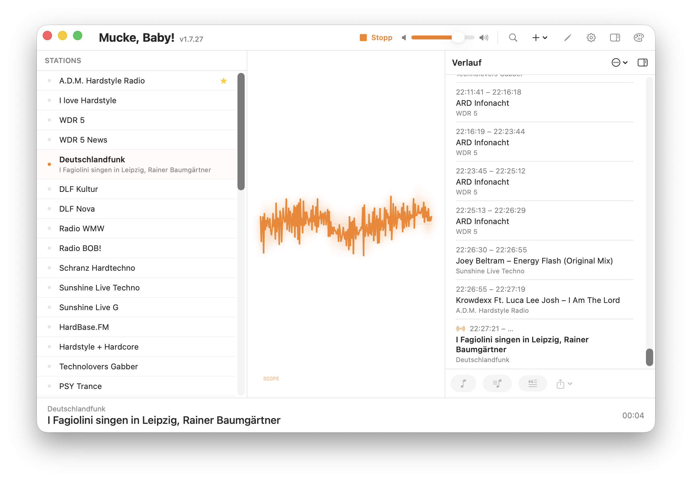
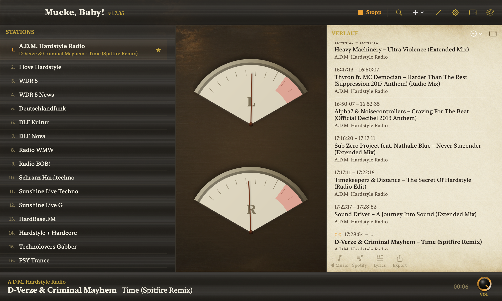
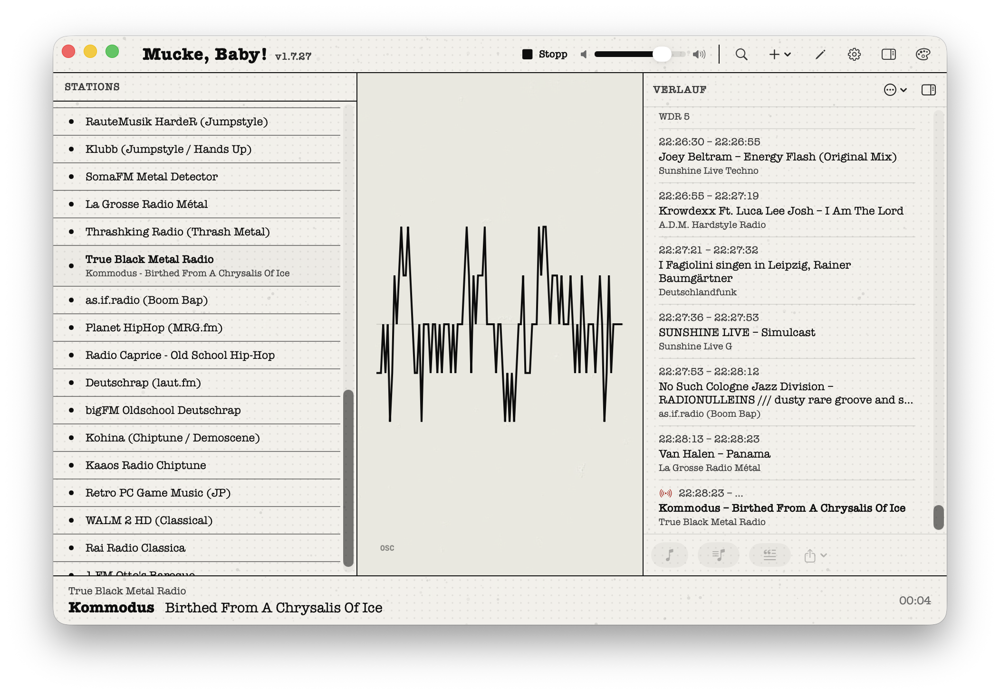
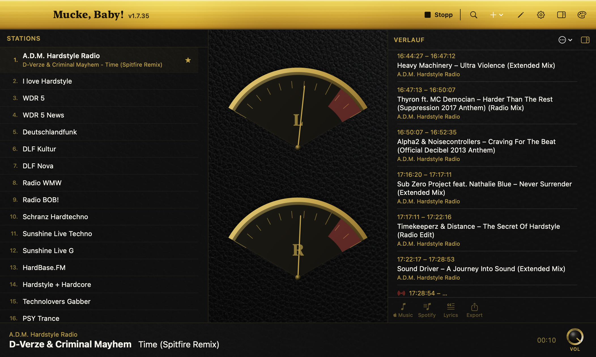
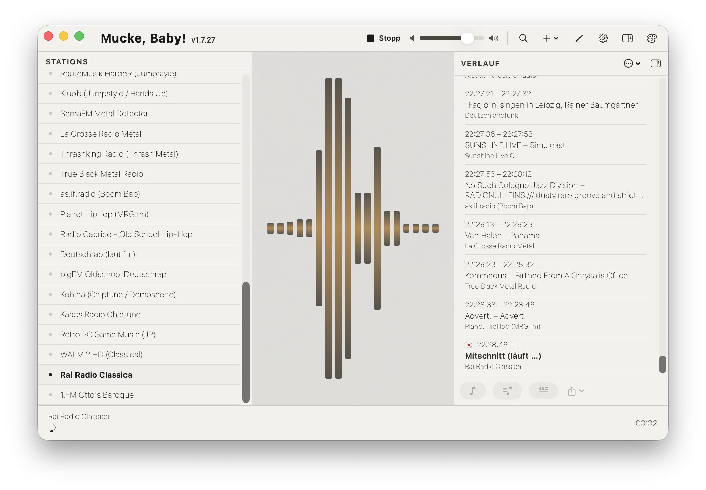
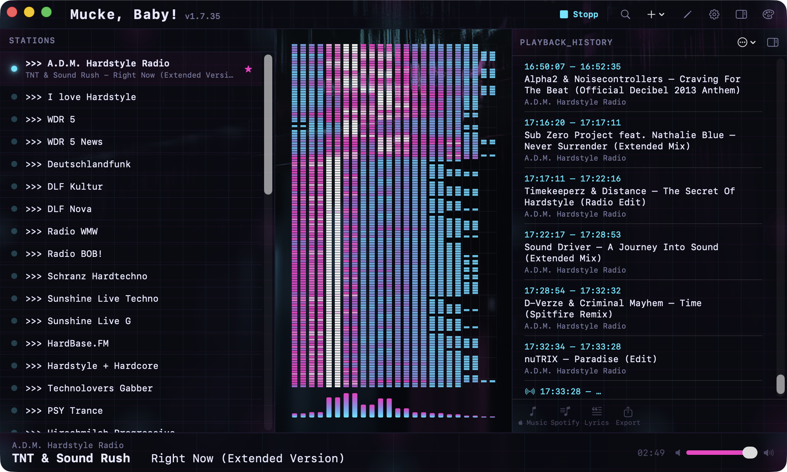

# Mucke, Baby!

**🌐 Sprache / Language:** [English](README.md) · [Deutsch](README.de.md)



Ein nativer macOS-Internetradio-Player (SwiftUI + VLCKit) mit sieben handgemachten Themes und audio-reaktiven Visualizern, die synchron zum tatsächlichen Klang laufen. Ursprünglich vom Linux-Mint-Applet **Radio++** inspiriert — inzwischen ein eigenständiges Projekt, mit Verlauf, Stream-Aufnahme (inkl. songweiser Extraktion), Direktlinks zu Apple Music / Spotify und mehr. Es gibt auch einen iPhone-Ableger: [Baby, Mucke!](https://github.com/DanielMuellerIR/baby_mucke).

## Download

**[➜ Aktuelles signiertes & notarisiertes DMG herunterladen](https://github.com/DanielMuellerIR/mucke_baby/releases/latest)** — öffnen, „Mucke, Baby!“ in den Programme-Ordner ziehen und doppelklicken. Mit Developer ID signiert und von Apple notarisiert, öffnet also ohne Gatekeeper-Warnung. Benötigt macOS 14.2 oder neuer (Apple Silicon).

Lieber selbst aus dem Quellcode bauen? Siehe [Starten](#starten-kommandozeile--headless-tauglich) weiter unten.

## Screenshots

<p align="center"></p>

| Standard | Retro | Fanzine |
|:--:|:--:|:--:|
|  |  |  |
| **GuitarAmp** | **Danish** | **Black MIDI** |
|  |  |  |

## Starten (Kommandozeile / headless-tauglich)

Kein Xcode-Projekt — die App wird mit `swiftc` zu einem `.app`-Bundle kompiliert. Erforderlich ist Xcode mit den Werkzeugen für App-Intents-Metadaten. Die gesamte Toolchain ist skriptbar (praktisch für Automatisierung und KI-Agenten):

```bash
./build.sh                                       # baut "build/Mucke, Baby!.app" (lädt VLCKit einmalig, ~84 MB)
./run.sh                                         # bauen + starten
open "build/Mucke, Baby!.app"                    # starten
"build/Mucke, Baby!.app/Contents/MacOS/MuckeBaby" # starten mit Logs (Debug)
```

### Headless / Automatisierung

- **Headless-Regressionstests:** `bash Tests/run-tests.sh` führt die vorhandenen Harnesses auf Apple-Silicon-macOS aus, ohne App-Start oder VLCKit-Download. HTTP-Fixtures nutzen ausschließlich Loopback. Der macOS-CI-Workflow führt denselben Befehl aus.
- **Exportcodecs und Schnittpositionen:** `python3 Tests/export-codecs.py` und `python3 Tests/export-positions.py` erzeugen temporäre Audiofixtures und dekodieren Exporte unabhängig mit FFmpeg. Die Positionsprüfung vergleicht markierte Schnitte mit und ohne Fade und prüft bytegleiche Vorhör- und Speicherdateien. Beide Befehle benötigen FFmpeg; lesbare Quellcodecs hängen von der macOS-Version ab.
- **Equalizer-Signalprüfung:** `python3 Tests/audio-effects.py` misst den gepinnten VLCKit-Equalizer über seinen PCM-Dateiausgang, unabhängig mit FFmpeg dekodiert. Geprüft werden neutraler Pegel, eine gezielte Bandabsenkung und Headroom. Der Dateiausgang besitzt keinen Lautstärkeregler; er ersetzt keine CoreAudio-, Stumm- oder Hörprüfung.
- **Automatische Theme-Screenshots:** `MUCKE_SHOTS=<verzeichnis>` setzen — die App schaltet durch alle Themes, schreibt je ein PNG und beendet sich. `MUCKE_SHOT_W=<punkte>` überschreibt die Fensterbreite; die Layoutbaseline nutzt 940 und 660 macOS-Punkte.
  ```bash
  MUCKE_SHOTS=/tmp/shots "build/Mucke, Baby!.app/Contents/MacOS/MuckeBaby"
  ```
  Dafür einen Testbenutzer verwenden oder vorher App-Preferences sichern und danach wiederherstellen: Der Screenshotlauf verändert das gewählte Theme. `CFFIXED_USER_HOME` isoliert Dateien, aber nicht zuverlässig den Preferences-Daemon.
- **Installieren oder Release bauen** — drei Einstiegspunkte, bewusst getrennt:
  ```bash
  ./build.sh                        # baut nur, bleibt in build/
  ./install.sh                      # baut, notarisiert, installiert nach /Applications
  ./release.sh                      # baut, notarisiert, packt das DMG — installiert nie
  ./release.sh --no-finder-layout   # ohne Finder-Fensterlayout (für headless Läufe)
  ```
  `install.sh` und `release.sh` notarisieren zuerst die **App selbst** und heften ihr das
  Ticket an. Das zählt hier doppelt: Eine aus dem Disk-Image herausgezogene App hätte sonst
  kein eigenes Ticket, und Sparkle entpackt die neue Version beim Update selbst.
  Der notarytool-Profilname kommt aus `NOTARY_PROFILE` oder
  `git config --local muckeBaby.notaryProfile <profil>` — Keychain-Profile sind pro Mac
  lokal und werden nie synchronisiert.

## Funktionen

- **Temporärer MP3-Puffer** — in den Einstellungen nach Bestätigung der automatischen Bereinigung aktivieren. Der Puffer verwendet die vorhandene Metadatenverbindung, hält höchstens fünf Minuten und 32 MiB komprimiertes Audio plus einen begrenzten Index und stoppt unter 10 GiB freiem Speicher. Abschalten, Senderwechsel und Beenden verwerfen das temporäre Audio. Dauerhafte Aufnahmen und Verlauf bleiben erhalten. Hauptfenster und Miniplayer teilen Pause/Fortsetzen, Pufferregler, Titelzeitleiste und Live. Live hält mindestens drei Sekunden Reserve. Sprünge folgen MP3-Framegrenzen; der Decoder-Vorlauf wird vor der Ausgabe verarbeitet.
- **Musik erkennen** — die Wellenform-Suche im Spielerfuß öffnen und „Erkennen“ wählen. Shazam erhält einen akustischen Fingerabdruck von bis zu 12 Sekunden der laufenden Musik; die Audiodatei wird nicht übertragen. Audiofreigabe und Internetverbindung sind erforderlich. Jederzeit abbrechen. Hauptfenster und Miniplayer bieten dieselbe Erkennung. Einen Katalogvorschlag bewusst für die aktuelle Anzeige übernehmen oder separat merken; ursprünglicher Sendertext und Shazam-Herkunft bleiben sichtbar. ⌘↵ übernimmt den Vorschlag für die Anzeige, ⌘S merkt ihn und Escape schließt den Dialog. Titel- und Senderwechsel beenden die Anzeigeübernahme. Katalogtreffer können eine andere Mix-Version nennen. Verlauf und Aufnahmen bleiben unverändert. Gemerkte Erkennungsergebnisse verwenden Austauschversion 2; ältere Apps können diese Dateien noch nicht importieren. Bei eigenen Builds muss ShazamKit unter „App Services“ der signierten App-ID aktiviert sein.

- Native macOS-Kurzbefehle können gespeicherte Sender starten, Radio stoppen, die Lautstärke setzen, den aktuellen Titel abfragen und merken. Parameter und Aufnahmeverhalten stehen unter [Kurzbefehle](docs/shortcuts.md).

- Spielt **alle Codecs** über VLCKit/libVLC (mp3, aac, **ogg, opus**, flac, …).
- **Sieben Themes**, je mit eigenem Layout, eigenen Texturen und eigenem Visualizer: Standard, Acid Rave, Retro, Fanzine, GuitarAmp, Danish, Black MIDI.
- **Visualizer im Vollbild:** Über **Darstellung → Visualizer im Vollbild** (⌘⇧V) öffnet sich die große Ansicht des aktuellen Themes. ⌃⌘F wechselt zwischen Fenster und Vollbild. ⌘B blendet die Bedienung ein oder aus; die Leertaste startet oder stoppt die Wiedergabe. Escape verlässt das Vollbild, Escape im Fenster kehrt zum Hauptfenster zurück. Titel, Wiedergabe und Lautstärke bleiben gemeinsam. Verdeckte Visualizer pausieren ihre Animation; bei reduzierter Bewegung in macOS bleibt die Ansicht ruhig.
- **Audio-reaktive Visualizer** — analoge VU-Nadeln, Oszilloskop, Spektrum-Balken und eine Piano-Roll — gespeist von einem **CoreAudio-Process-Tap** auf die eigene Tonausgabe. Das getappte Signal wird vor der Analyse normalisiert, damit leiseres Hören den Visualizer nicht kleiner macht; das Bild bleibt perfekt synchron und flüssig (bis zu 30 Bilder pro Sekunde).
- **Now-Playing** (Interpret/Titel) über einen eingebauten ICY-Metadaten-Leser (markier- und kopierbar), mit korrekter Dekodierung von Nicht-UTF-8-Sendern (UTF-8 → Shift-JIS/CP932 → Latin-1, z. B. japanische Sender).
- **Verlauf** — jeder Titel mit Datum, Start-/Endzeit und Sender, auch über Senderwechsel hinweg. Suche nach Titel oder Interpret sowie kombinierbare Sender- und Zeitraumfilter helfen beim Wiederfinden. Zeiträume umfassen ganze Kalendertage, einschließlich darin noch laufender Titel.
- **Merkliste** — Titel aus dem Verlauf oder der aktuellen Wiedergabe mit dem Herz dauerhaft merken. Die Liste speichert Metadaten unabhängig von Verlauf und Aufnahmen, bietet Suche und Musiklinks und exportiert die sichtbaren Treffer als UTF-8-Text oder CSV. Verschiedene Mixe bleiben getrennt.
- **Getrennte Löschaktionen** — Verlaufleeren erhält alle Aufnahmen. „Alle Aufnahmen löschen“ entfernt nach Bestätigung nur abgeschlossene Aufnahmen; der Verlauf und eine laufende Aufnahme bleiben erhalten.
- **Aufnahmebibliothek** — abgeschlossene und laufende Mitschnitte unabhängig vom Verlauf finden, mit Datum, Dauer, Größe, Finder-Aktion und lokalem Vorhören. Vorhören fragt vor dem Beenden von Live-Radio. Das Entfernen einer ausgewählten abgeschlossenen Aufnahme braucht Bestätigung; der Verlauf bleibt erhalten. Im Verlauf ist vollständiges und teilweise verfügbares Audio von fehlenden Dateien unterscheidbar.
- **Export vorhören und schneiden** — Der Songexport öffnet einen Dialog mit Anfangs-/Endkorrektur und optionalen Ein-/Ausblendungen. Vorhören verwendet genau die vorbereitete M4A-Datei, die gespeichert wird. ⌘⇧P startet oder stoppt die Vorschau; Escape schließt den Dialog. Vorhören fragt vor dem Beenden von Live-Radio; anschließend den Sender bei Bedarf manuell starten. Änderungen betreffen den exportierten Ausschnitt, Aufnahme und Verlauf bleiben erhalten.
- **Exportmetadaten und mehrere Titel** — M4A-Dateien erhalten Interpret, Titel und Mix-Version. Der Sender steht im Album-Feld, ursprünglicher ICY-Text und Aufnahmezeit im Kommentar. Das Exportmenü im Verlauf wählt bis zu 100 Titel für einen seriellen Stapel aus. Einzelne oder verbleibende Exporte lassen sich abbrechen; jeder Eintrag zeigt sein Ergebnis. Vorhandene Stapeldateien erhalten einen nummerierten Zusatz und werden nicht ersetzt.

- **Miniplayer** — ein kompaktes Fenster teilt Wiedergabe, Senderauswahl, Lautstärke, Merkliste und Aufnahmebedienung mit dem Hauptfenster. Optional im Vordergrund halten und ohne Wiedergabeneustart zum Hauptfenster zurückkehren.
- **Audioeinstellungen** — manuelle Korrektur von −12 bis +12 dB je lokalem Sender speichern. Die korrigierte Wiedergabelautstärke bleibt auf 100 % begrenzt. Ein optionaler Zehnband-Equalizer bietet vier Vorgaben, eigene Bänder und Pegelreserve. Hauptfenster und Miniplayer öffnen dasselbe Einstellungsfenster; Aufnahmen und Exporte bleiben unbearbeitet. Kein automatischer Lautheitsabgleich.
- **Optionale Stream-Aufnahme** (standardmäßig aus) — schneidet den laufenden Stream nach `~/Music/MuckeBaby/Aufnahmen/` mit, inkl. songweiser Extraktion; stoppt automatisch bei unter 10 GiB frei.
- **Direkte Aufnahmebedienung** — während des Hörens ein- und ausschalten; Hauptfenster und Menüleiste zeigen den tatsächlichen Zustand. Erst erfolgreich geschriebene Audiobytes zählen als aktive Aufnahme. Warte-, Speicher- und Schreibfehler bleiben erkennbar. Die bestehende Metadatenverbindung bleibt dafür auch bei Sendern ohne Titelmeldungen offen; unter 10 GiB freiem Speicher stoppt die Aufnahme. Für vollständige Dateiheader von Ogg, Opus und FLAC wird nur diese Metadatenverbindung erneuert; der Audio-Player läuft weiter.
- **Direktlinks** aus dem Verlauf, um einen Titel in Apple Music oder Spotify nachzuschlagen.
- **Sendergruppen und Schnellauswahl** — eigene Sender nach Namen oder URL suchen und mit Favoriten oder einer Gruppe kombinieren. Ein Sender kann mehreren benannten Gruppen angehören; Gruppenlöschung erhält alle Sender. ⌘K öffnet die Tastaturauswahl, fünf konfigurierbare Plätze verwenden ⌥⌘1–5. Schnellplätze bleiben lokal.
- **Bibliothek austauschen** — Sender mit Favoriten und Katalogherkunft, Gruppen und gemerkte Titel als [versioniertes JSON](docs/library-exchange.md) exportieren. Aktuelle und alte Senderdateien über eine Vorschau mit ausdrücklicher Konfliktwahl importieren: lokal behalten, Import übernehmen oder beide behalten. Aufnahmen, Verlauf und Geräteeinstellungen bleiben lokal.
- **Metadaten-Erholung** — die Titelverbindung erhält eigene begrenzte Wiederholungen. Ruhezustand beendet die empfangenen Abschnitte; Aufwachen setzt nur zuvor ausdrücklich gewünschte und inzwischen nicht gestoppte Wiedergabe fort.
- **macOS-Mediensteuerung** — Sender und Titel im Kontrollzentrum anzeigen. Medienpause pausiert gepufferte Wiedergabe und stoppt direkte Live-Streams; Vor/Zurück folgt der gespeicherten Reihenfolge sichtbarer Sender, unabhängig von Ansichtsfiltern. Stopp und Beenden geben die Systemsteuerung frei.
- **Verbindungserholung** — nach einem Streamfehler höchstens drei automatische Wiederholungen mit 2, 5 und 15 Sekunden Abstand. Die App überwacht den Wiedergabefortschritt und setzt bei Netzrückkehr nur einen wartenden Auftrag fort. Stopp verwirft alle Wiederholungen; nach einer Minute stabiler Wiedergabe steht das begrenzte Budget erneut bereit.
- **Senderadresse reparieren** — Katalogimporte behalten eine optionale Radio-Browser-ID. Im Sendereditor die Katalogadresse prüfen, bisherige und vorgeschlagene URL vergleichen und die URL ausdrücklich speichern. Lokale Identität, eigener Name, Favoriten, Gruppen und Schnellplätze bleiben erhalten. Laufende Wiedergabe behält ihre Verbindung; die neue Adresse gilt beim nächsten manuellen Start. Sender ohne gespeicherte Katalogherkunft bleiben manuell bearbeitbar. JSON-Export und -Import erhalten die optionale Herkunft.
- **Katalogfilter und gespeicherte Treffer** — Land, Sprache, Genre, Name, Codec und Mindestbitrate des Katalogs gemeinsam filtern. Je Seite erscheinen höchstens 50 Treffer, sortiert nach Stimmen oder Namen. Bis zu 20 Seiten bleiben in einem auf 2 MiB begrenzten lokalen Cache verfügbar. Gespeicherte Treffer zeigen ihr Alter und belegen keine aktuelle Sendererreichbarkeit.
- Senderliste mit Play/Stop, Ein-/Ausblenden und Umsortieren pro Sender; mehrere **Favoriten**, unabhängig von der Startauswahl. In den Einstellungen stehen kein Autostart, letzter Sender oder ein bestimmter Sender zur Wahl. Fehlende oder ausgeblendete Startziele lassen die Wiedergabe aus. Bestehende Startpräferenzen werden einmalig übernommen.
- Sender hinzufügen / bearbeiten / löschen; **kuratierte Genre-Listen** per Klick importieren.
- Playlist-Auflösung für `.pls` / `.m3u` / `.asx` / `.xspf` / radiotime `Tune.ashx`.
- **Sender-Katalog** aus der offenen API von [radio-browser.info](https://www.radio-browser.info) — nach Genre stöbern, per Name suchen, Sender **probehören** und mit einem Klick übernehmen.
- Hell- & Dunkelmodus; optionales Menüleisten-Symbol (standardmäßig aus).
- **Selbst-Updates über Sparkle** — die App prüft einen signierten Appcast (GitHub Pages) und installiert nur nach Bestätigung; keine Telemetrie, kein System-Profiling.

### Berechtigung für die Audio-Reaktivität

Die Visualizer lesen die eigene Tonausgabe über einen CoreAudio-Process-Tap. Beim ersten Start fragt macOS **einmalig** nach der Erlaubnis zur Audioaufnahme; sie ist für die reaktiven Visuals nötig (mit Developer-ID-Signatur wird die Erlaubnis dauerhaft gemerkt). Die App-Lautstärke wird vor der Analyse herausgerechnet; bei komplett stummer Wiedergabe gibt es kein Signal zum Rekonstruieren. Ohne Erlaubnis spielt die App trotzdem — die Visualizer ruhen dann nur.

## Daten

Die Sender liegen in einer editierbaren JSON-Datei:

```
~/Library/Application Support/MuckeBaby/stations.json
```

Beim ersten Start wird sie aus `Resources/seed-stations.json` befüllt, falls vorhanden, sonst aus der generischen `Resources/seed-stations.example.json` (die einzige mitgelieferte Liste).

## Fremdbestandteile & Lizenzen

Vollständige Aufstellung in [`THIRD-PARTY.md`](THIRD-PARTY.md). Kurz:

- **VLCKit / libVLC** — **LGPL-2.1-or-later**, dynamisch gelinkt und im Bundle austauschbar. Quelle: <https://code.videolan.org/videolan/VLCKit>.
- **Theme-Texturen & App-Icon** — lokal mit einem Apache-2.0-Modell erzeugt (kommerzielle Nutzung erlaubt).
- **Schriften** — macOS-Systemschriften (nicht mitgeliefert). **Sender-URLs** sind Fakten; die Streams gehören den jeweiligen Sendern.

**Projekt-Lizenz:** [MIT](LICENSE) für den eigenen Quellcode dieses Projekts. Das eingebettete VLCKit/libVLC behält seine **LGPL-2.1-or-later**-Lizenz (dynamisch gelinkt und austauschbar; Pflichten erfüllt durch diesen Hinweis + den Quell-Link oben).

## Voraussetzungen

macOS **14.2+**, Apple Silicon, Xcode einschließlich der Werkzeuge für App-Intents-Metadaten.

---

*Status: privates Projekt. Ursprünglich vom Linux-Mint-Applet „Radio++" angestoßen und inzwischen weit darüber hinausgewachsen — es wurde kein Code und kein Asset von Radio++ übernommen.*

Der Einschlaftimer im Hauptfenster und in der Menüleiste bietet Vorgaben und eine eigene Dauer. Er lässt sich verlängern oder abbrechen; am Ende blendet die Wiedergabe aus. Die gespeicherte Lautstärke gilt beim nächsten Start weiter.
