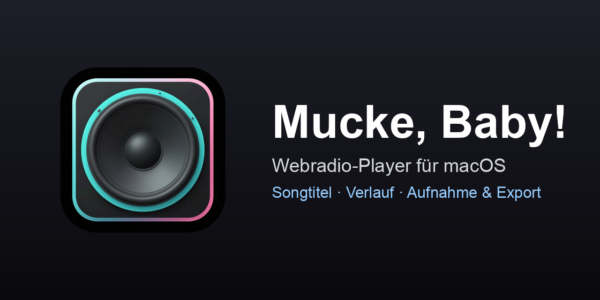
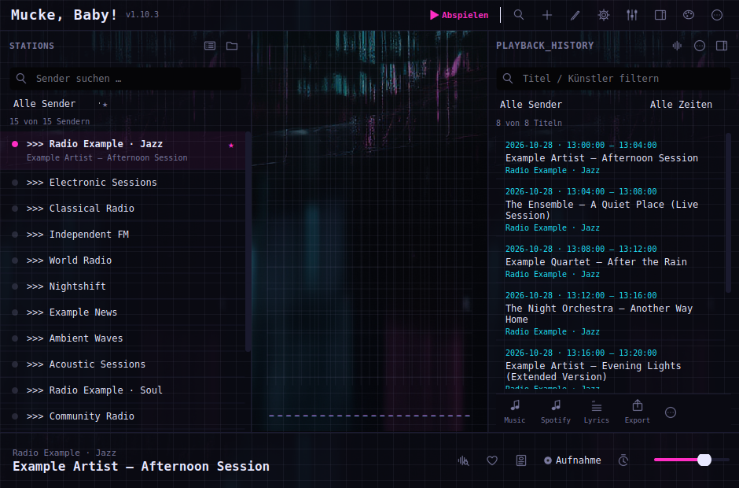
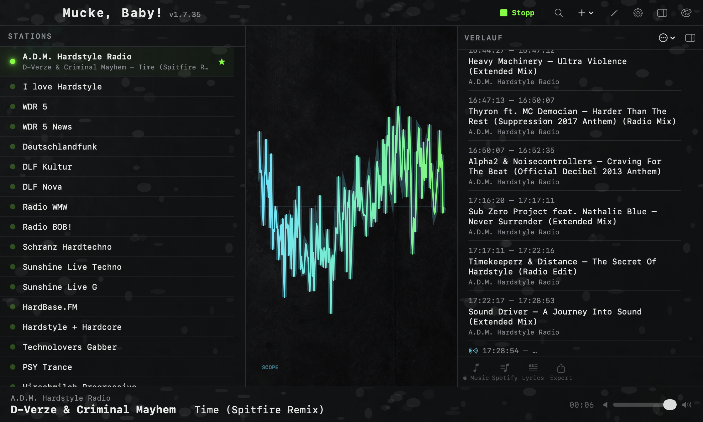
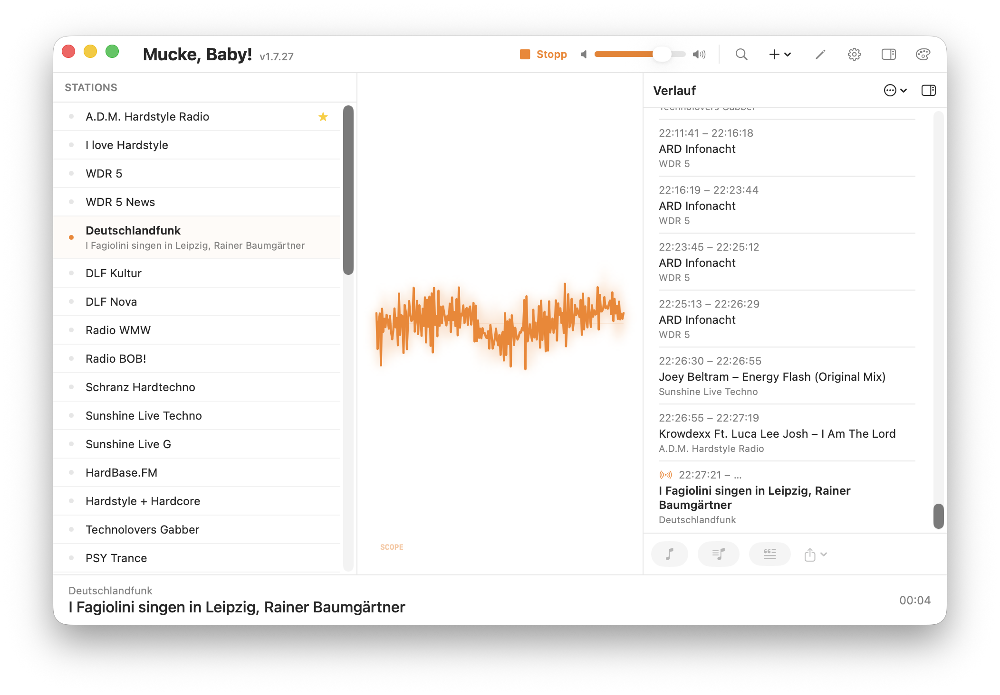
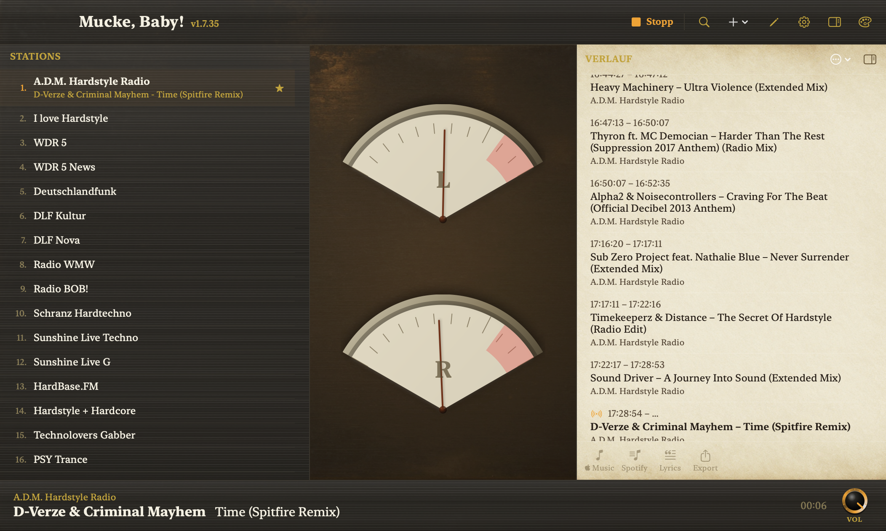
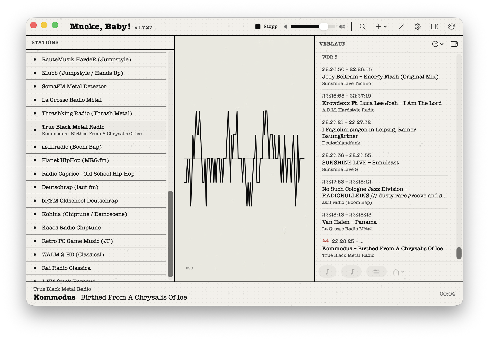
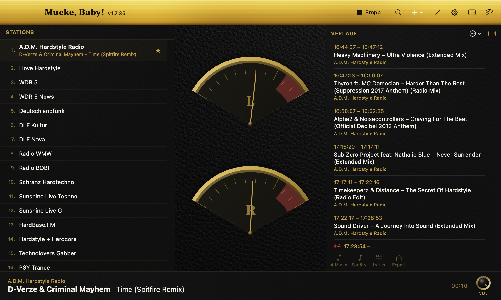
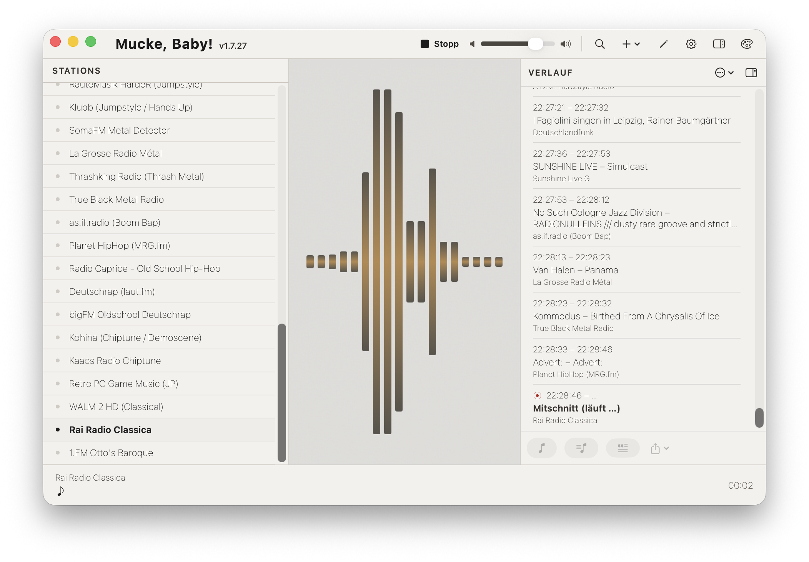
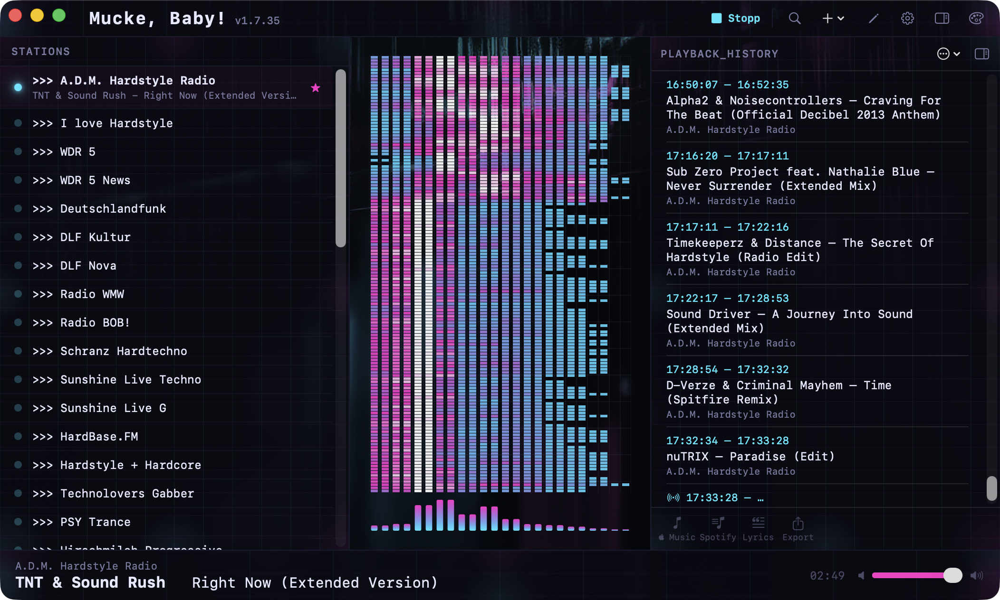

# Mucke, Baby!

**🌐 Sprache / Language:** [English](README.md) · [Deutsch](README.de.md)



Mucke, Baby! is a native internet-radio player for macOS and Linux with seven visual themes, audio-reactive visualizers, listening history and optional stream recording with per-song export.

The interface is available in German and English. The iPhone sibling is [Baby, Mucke!](https://github.com/DanielMuellerIR/baby_mucke).

## Download

- **Linux x86-64:** [Download version 1.10.14](https://github.com/DanielMuellerIR/mucke_baby/releases/tag/v1.10.14). The TAR.GZ archive includes a per-user installer; Qt, libVLC 3 and FFmpeg come from system packages. Follow the [Linux guide](docs/linux.md) to check the checksum, install dependencies and run `./install.sh`.
- **macOS 14.2+, Apple Silicon:** [Download the signed and notarized DMG, v1.10.14](https://github.com/DanielMuellerIR/mucke_baby/releases/tag/v1.10.14). Open it and drag *Mucke, Baby!* into Applications.

## Linux

The native Qt 6 application has been tested on Linux Mint 22 and CachyOS on x86-64. It includes radio playback, ICY history, stations and groups, catalog search, bookmarks, recording, per-song M4A export, bounded MP3/AAC timeshift, seven themes, a miniplayer, equalizer, sleep timer and MPRIS desktop controls.

Updates can be checked and installed from **Help → Check for updates**; optional startup checks are available in Settings. Qt, libVLC 3 and FFmpeg come from system packages. ShazamKit identification, Apple Shortcuts and Sparkle updates are specific to macOS. Build from source with `./build.sh` and `./install.sh`; installation, data paths, codec limits and tests are covered in the [Linux guide](docs/linux.md).

Black MIDI is the default Linux theme. Below 780 pixels in window width, the center visualizer disappears. Its analysis pauses when no other visualizer window is visible; radio playback continues.



## Screenshots

The following screenshots show the macOS application. The Linux screenshot above shows its native Qt interface with the same seven themes.

<p align="center"></p>

| Standard | Retro | Fanzine |
|:--:|:--:|:--:|
|  |  |  |
| **GuitarAmp** | **Danish** | **Black MIDI** |
|  |  |  |

## Run it on macOS (CLI / headless‑friendly)

No Xcode project — the app is compiled with `swiftc` into a `.app` bundle. Xcode with its App Intents metadata tools is required. The build runs through shell scripts.

```bash
./build.sh                                       # build -> "build/Mucke, Baby!.app" (downloads VLCKit once, ~84 MB)
./run.sh                                         # build + launch
open "build/Mucke, Baby!.app"                    # launch
"build/Mucke, Baby!.app/Contents/MacOS/MuckeBaby" # launch with logs (debug)
```

### Headless / automation

- **Headless regression tests:** `bash Tests/run-tests.sh` runs the existing harnesses on Apple Silicon macOS, without launching the app or downloading VLCKit. HTTP fixtures use loopback only. The macOS CI job runs the same command and builds and verifies the app with the pinned frameworks.
- **Export codec and position checks:** `python3 Tests/export-codecs.py` and `python3 Tests/export-positions.py` generate temporary audio fixtures and independently decode exports with FFmpeg. The position check compares marked cuts with and without fades and verifies that preview and saved files have identical bytes. Both commands require FFmpeg; source codec support depends on the macOS version.
- **Equalizer signal check:** `python3 Tests/audio-effects.py` measures the pinned VLCKit equalizer through its PCM file output, independently decoded with FFmpeg. It checks neutral gain, a selective band cut and headroom. The file output does not implement volume control, so it does not replace CoreAudio volume, mute or listening checks.
- **Automatic theme screenshots:** set `MUCKE_SHOTS=<dir>` — the app cycles through all themes, writes one PNG per theme and quits. `MUCKE_SHOT_W=<points>` overrides the window width; the layout baseline uses 940 and 660 macOS points.
  ```bash
  MUCKE_SHOTS=/tmp/shots "build/Mucke, Baby!.app/Contents/MacOS/MuckeBaby"
  ```
  Use a test account or save and restore app preferences first: the screenshot run changes the selected theme. `CFFIXED_USER_HOME` isolates files but does not reliably isolate the preferences daemon.
- **Install or release** — three entry points, deliberately separated:
  ```bash
  ./build.sh                        # build only, stays in build/
  ./install.sh                      # build, notarize, install into /Applications
  ./release.sh                      # build, notarize, package the DMG — never installs
  ./release.sh --no-finder-layout   # skip the Finder window layout (headless runs)
  ```
  Both `install.sh` and `release.sh` notarize the **app itself** and staple its ticket first.
  That matters twice over here: an app dragged out of a notarized disk image would otherwise
  carry no ticket, and Sparkle unpacks the new version on its own during an update.
  The notarytool profile name comes from `NOTARY_PROFILE` or
  `git config --local muckeBaby.notaryProfile <profile>` — keychain profiles are local to
  each Mac and never synchronized.

## macOS features

### Playback and appearance

- **Internet radio** plays MP3, AAC, Ogg/Vorbis, Opus, FLAC and other formats through VLCKit. It resolves PLS, M3U, ASX, XSPF and Tune.ashx playlists. Start manually, resume the last station or choose a startup station. The app retries playback and metadata independently after interruptions.
- **Timeshift** uses the existing stream connection for an optional MP3 or AAC-ADTS buffer. The main window and miniplayer share pause, seek, the title timeline and the return to live. The buffer holds up to five minutes and 32 MiB of compressed audio, stops below 10 GiB free and clears on station change or quit. HLS is live only. See [buffer and format limits](docs/timeshift-buffer.md).
- **Seven themes** offer a main window, an optionally floating miniplayer and a fullscreen visualizer. The ten-band EQ, station gain correction and sleep timer affect playback. Recordings keep the original audio.

### Stations, history and bookmarks

- **Your stations** can be reordered, grouped, searched and marked as favorites. Open quick selection with ⌘K or assign five shortcuts. Import curated genre lists or browse, filter and preview stations from [Radio Browser](https://www.radio-browser.info). For stations from the catalog, compare and confirm URL repairs before saving.
- **Listening history** shows ICY titles and broadcasts by station and time. Filter by date or title, look up tracks on Apple Music or Spotify, and save bookmarks independently. The bookmark list exports the visible results as UTF-8 text or CSV.
- **Library exchange** previews imports and lets you resolve conflicts before writing stations, groups and bookmarks. Recordings, history and device settings stay local. See [exchange formats](docs/library-exchange.md).

### Recording and export

- **Stream recording** starts only when enabled and writes audio to `~/Music/MuckeBaby/Aufnahmen/`. The recorder uses the existing metadata connection, stops below 10 GiB free and shows waiting, active and error states. The recording library lists files independently of history and previews completed recordings.
- **M4A export** opens a track editor with start/end adjustments and optional fades. Preview plays the exact prepared file. Export retains song and station metadata. Batch export processes up to 100 tracks with individual results and cancellation.
- **Deletion** requires confirmation before clearing the entire history, which keeps recordings. The separate action for all recordings removes completed files and keeps history and any active recording.

### macOS integration

- **Media controls and Shortcuts** expose the current station and title in Control Center. The app supports saved station playback, Stop, volume, title lookup and bookmarks through [Apple Shortcuts](docs/shortcuts.md).
- **Identify music** opens from the waveform search button in the player. Shazam receives a fingerprint of up to 12 seconds of heard audio. You can cancel, use the match for the current display or save it separately with its source. Identification requires audio permission and internet access. Custom builds need ShazamKit enabled for their signed App ID.
- **Updates** use a signed Sparkle feed and require confirmation before installation. The app has no telemetry or accounts.

### Audio permission

The visualizers and music identification analyze the app's own output with a CoreAudio process tap. macOS may ask for permission when the tap first starts. A consistent Developer ID and bundle identifier let macOS recognize the app across builds. Radio playback works without this permission. At zero volume there is no output for the visualizers to analyze.

## Data

On macOS, stations live in an editable JSON file:

```
~/Library/Application Support/MuckeBaby/stations.json
```

On first launch it is seeded from `Resources/seed-stations.json` if present, otherwise from the generic `Resources/seed-stations.example.json` (the only list that ships).

## Third‑party & licensing

See [`THIRD-PARTY.md`](THIRD-PARTY.md) for the full breakdown. In short:

- **VLCKit / libVLC** — **LGPLv2.1‑or‑later**, dynamically linked and replaceable inside the bundle. Source: <https://code.videolan.org/videolan/VLCKit>.
- **Theme textures & app icon** — generated locally with an Apache‑2.0 model.
- **Qt 6 and libpulse** — system libraries on Linux; full notices and source links are in `THIRD-PARTY.md`.
- **Fonts** — system fonts; the Linux Fanzine theme includes Zilla Slab under the SIL Open Font License 1.1. **Station URLs** are facts; the streams belong to their broadcasters.

**Project license:** [MIT](LICENSE) for this project's own source code. The bundled VLCKit/libVLC keeps its **LGPL‑2.1‑or‑later** license (dynamically linked and replaceable; obligations met by this notice + the source link above).

## Requirements

- **macOS source build:** macOS 14.2+, Apple Silicon and Xcode, including the App Intents metadata tools.
- **Linux:** x86-64, Qt 6.4 or newer, libVLC 3 and PulseAudio or PipeWire-Pulse. FFmpeg is needed for export. See [runtime and build dependencies](docs/linux.md).


Inspired by the Linux Mint Radio++ applet; no Radio++ code or assets are included.
